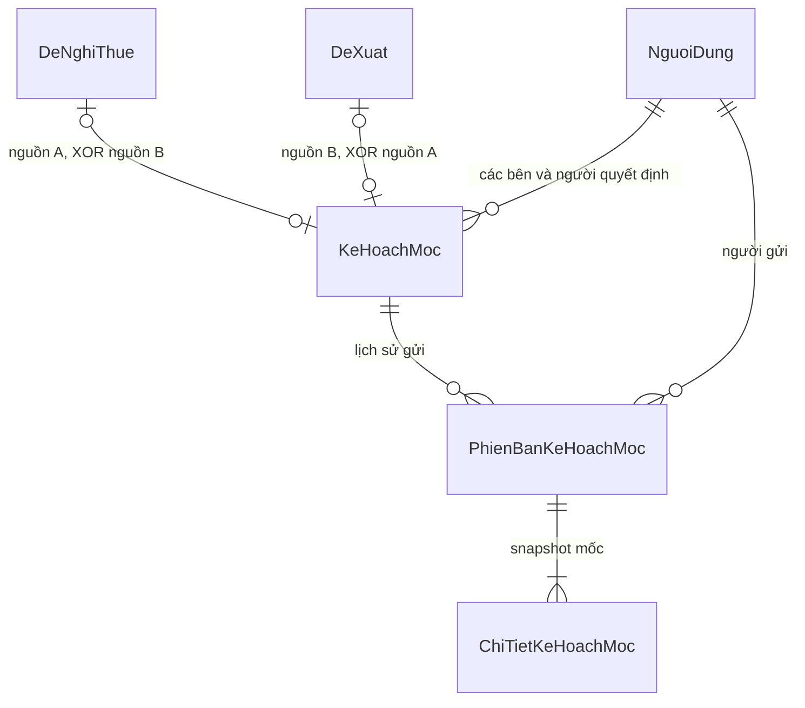

# Mở rộng V6: kế hoạch mốc trước hợp đồng

Phần này bổ sung riêng cho ERD cơ sở; không sửa 12 bảng, 106 thuộc tính và 21 FK trong `ERD_BIZ04_CoSo.json`. Không thay `HopDong`, `MocNghiemThu` hoặc các bảng tài chính. V1–V5 giữ nguyên.

V6 thêm ba bảng, 46 cột, 9 FK. Nguồn schema: `src/main/resources/db/migration/V6__ke_hoach_moc_truoc_hop_dong.sql`.

| Bảng | Mục đích | Quan hệ chính |
|---|---|---|
| `KeHoachMoc` · 22 cột | Định danh luồng, snapshot nguồn/các bên/giá/thời lượng, trạng thái, lượt phản hồi, phiên bản chốt hoặc quyết định hủy | Một trong `MaDeNghi` và `MaDeXuat` có giá trị; unique index có điều kiện trên từng nguồn. Các bên/bên chờ/người quyết định tham chiếu `NguoiDung`. |
| `PhienBanKeHoachMoc` · 10 cột | Bản gửi bất biến: số phiên bản, người gửi, operation key, cách chia, lý do, snapshot tỷ lệ/quy tắc phí và thời điểm | Thuộc một kế hoạch; unique `(MaKeHoach,SoPhienBan)` và `(MaKeHoach,MaGui)`. |
| `ChiTietKeHoachMoc` · 14 cột | Snapshot từng mốc: định danh ổn định, thứ tự, tên/công việc/sản phẩm/tiêu chí, hạn tương đối/đơn vị, giá/phí/thực nhận và số lần sửa | Thuộc một phiên bản; unique định danh và thứ tự trong phiên bản. |

`INITIAL` là trạng thái đọc suy ra khi nguồn đủ điều kiện nhưng chưa có bản gửi, không phải bản nháp lưu trong DB. Chỉ khi gửi cuối mới có phiên bản 1 và các mốc. Hủy trước bản gửi đầu có thể tạo bản ghi kết thúc `DA_HUY`/phiên bản hiện tại 0 để lưu quyết định; không có phiên bản hoặc nội dung mốc nháp.

Các bản đã gửi dùng `CHO_PHAN_HOI`, `DA_THONG_NHAT`, `DA_HUY`. Chỉ bên nhận bản mới nhất phản hồi; cả hai bên được hủy trước khi thống nhất. Không cập nhật hoặc xóa snapshot lịch sử qua service. `PhienBanKeHoachMoc` và `ChiTietKeHoachMoc` có `@Immutable`; mọi thay đổi hợp lệ thêm bản mới.

Snapshot nguồn gồm ID nguồn và các bên, tên các bên, tiêu đề/phạm vi/sản phẩm, tổng giá, thời lượng và dấu vân tay nội dung. Nguồn thuê giữ số phiên bản thuê đã thống nhất; nguồn đề xuất hiện không có version native nên dùng snapshot và dấu vân tay để phát hiện nội dung thay đổi. Không sao chép CCCD, mật khẩu hay khóa bảo mật.

Thời hạn lưu tương đối, không gán ngày bàn giao khi chưa có ngày bắt đầu. Hai nguồn hiện chỉ có số ngày; các mốc gửi trong đợt này dùng `DAY`. Chọn `MONTH` khi thiếu cơ sở tháng/ngày bắt đầu phải báo thiếu thông tin, không đổi thành 30 ngày. Hàm cộng tháng chuẩn bị sẵn dùng ngày bắt đầu gốc và ngày cuối tháng đích nếu thiếu ngày tương ứng; không cộng lặp từ ngày tháng trước đã bị cắt.

Mỗi phiên bản lưu tỷ lệ `0.1000` và quy tắc `DEDUCT_EXPERT_ALLOCATION_HALF_UP`. Phí/thực nhận dự kiến lưu trên từng mốc; tổng được cộng từ các mốc, không tính phí lần hai trên tổng và không ghi giao dịch tiền.

**Chưa có FK từ hợp đồng đến kế hoạch trong V6.** Đợt tích hợp hợp đồng sau phải tham chiếu phiên bản kế hoạch đã chốt và chụp lại toàn bộ snapshot. Không dùng `MocNghiemThu` cũ để lưu mốc trước hợp đồng, không tạo yêu cầu/đề xuất hoặc hợp đồng giả.
