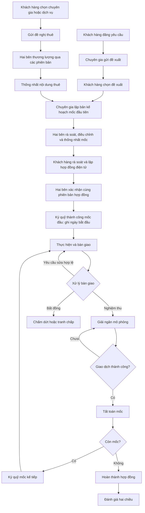
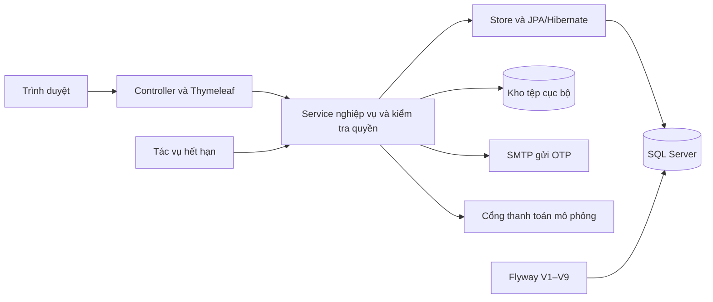

# Sang Connect — Tổng hợp nội dung phục vụ báo cáo đồ án

Ngày đối chiếu: 10/11/2026, giờ Việt Nam. Sinh viên: **Mai Phước Sang — 1250080159 — 12_CNPM2**.

## 1. Mục đích và thứ tự thực hiện

Theo yêu cầu ngày 10/11/2026: đọc lại nội dung đã làm và dự kiến làm; mô tả đồ án theo phạm vi hoàn chỉnh để viết báo cáo trước, sau đó hoàn thiện nghiệp vụ còn thiếu. Người dùng sẽ cung cấp yêu cầu bố cục riêng. Tài liệu này là nguồn nội dung chuẩn bị, chưa thay cho báo cáo theo mẫu trường.

Phạm vi chức năng hoàn chỉnh có thể được trình bày thống nhất trong phần phân tích, thiết kế và mô tả hệ thống. Riêng chương kết quả, kiểm thử và ảnh minh chứng phải dựa trên bằng chứng thực tế. Các phần chưa triển khai được theo dõi ở [danh sách hoàn thiện](VIEC_CAN_HOAN_THIEN_SAU_BAO_CAO_2026-11-10.md), tránh đánh dấu đã kiểm thử chỉ từ giả định hoàn thành.

Đã truy xuất lịch sử chat **“Chạy web này”**, đọc các tài liệu bàn giao trong dự án, đối chiếu các service nghiệp vụ chính, route, migration và báo cáo kiểm thử lưu trên đĩa. Đã đọc metadata và một số trạng thái cần thiết của BIZ04 bằng SQL chỉ đọc. Không chỉnh mã nghiệp vụ, chạy migration, gửi email hoặc thay đổi dữ liệu thật trong lần tổng hợp này.

## 2. Tên đề tài, bài toán và mục tiêu

**Tên đề tài:** Xây dựng nền tảng marketplace dịch vụ chuyên gia Sang Connect.

**Khẩu hiệu:** Bạn mang ý tưởng, Sang Connect kết nối chuyên gia.

Hệ thống kết nối khách hàng cá nhân hoặc tổ chức với chuyên gia cung cấp dịch vụ. Quy trình cộng tác bao gồm tìm đối tác, thống nhất công việc và chi phí, chia sản phẩm thành các mốc có tiêu chí nghiệm thu, xác nhận hợp đồng, ký quỹ từng mốc, bàn giao, xử lý phản hồi và tất toán. Khi phát sinh bất đồng, hệ thống giữ tiền và lưu hồ sơ bằng chứng để quản trị viên xử lý. Đánh giá hai chiều được công khai theo điều kiện nhằm hạn chế tác động của đánh giá trước lên bên còn lại.

Các mục tiêu của đồ án:

1. Quản lý tài khoản, hồ sơ, xác thực email và quyền theo từng tác nhân.
2. Cung cấp hai cách bắt đầu hợp tác: khách hàng đăng yêu cầu để nhận đề xuất; hoặc chủ động gửi đề nghị thuê tới chuyên gia.
3. Lưu quá trình thương lượng, bản kế hoạch mốc và hợp đồng theo phiên bản có thể đối chiếu.
4. Quản lý tiến độ và tiền mô phỏng theo từng mốc, gắn giải ngân với nghiệm thu và kết quả giao dịch.
5. Hỗ trợ chấm dứt, tranh chấp, bằng chứng, đánh giá và nhật ký xử lý.

## 3. Tác nhân và trách nhiệm

| Tác nhân | Trách nhiệm chính |
|---|---|
| Khách truy cập | Xem trang chủ, giới thiệu, tìm kiếm và danh sách công khai; đăng ký hoặc đăng nhập để mở chi tiết được bảo vệ. |
| Khách hàng | Quản lý hồ sơ; đăng yêu cầu, chọn đề xuất hoặc gửi đề nghị thuê; thương lượng mốc; lập và xác nhận hợp đồng; ký quỹ, nghiệm thu, yêu cầu sửa, đánh giá hoặc xử lý bất đồng. |
| Chuyên gia | Đăng ký và gửi hồ sơ xét duyệt; quản lý dịch vụ, gửi duyệt nội dung; tìm dự án/gửi đề xuất; phản hồi đề nghị thuê; lập bản kế hoạch mốc đầu tiên; xác nhận hợp đồng, bàn giao và đánh giá khách hàng. |
| Quản trị viên | Duyệt hồ sơ chuyên gia và dịch vụ; quản lý tài khoản theo quyền; tra cứu nghiệp vụ, xử lý tranh chấp, ẩn đánh giá vi phạm có lý do và xem nhật ký. Không xác nhận hợp đồng thay các bên. |
| Tác vụ định kỳ | Xử lý nghiệm thu hết hạn đủ điều kiện và công khai đánh giá khi đủ hạn. |

Quyền được kiểm tra tại máy chủ theo người đăng nhập và quan hệ sở hữu thực tế. Việc ẩn nút trên giao diện chỉ hỗ trợ sử dụng, không thay thế kiểm tra quyền.

## 4. Hai luồng hình thành hợp tác

`DeXuat` và `DeNghiThue` là hai nguồn độc lập. Cả hai hội tụ vào kế hoạch mốc và hệ thống hợp đồng hiện có. Thuê trực tiếp không tạo yêu cầu hoặc đề xuất giả để đáp ứng khóa ngoại.

## 5. Danh mục chức năng và dữ liệu

Mã NB bên dưới dùng riêng để liên kết nội dung báo cáo với kế hoạch hoàn thiện; chưa thay thế cách đánh số use case của trường hoặc UC01–UC15 trong tài liệu gốc.

| Mã | Nhóm nghiệp vụ | Nội dung | Thành phần chính |
|---|---|---|---|
| NB01 | Đăng ký khách hàng | Kiểm tra thông tin, email duy nhất, mật khẩu băm; tài khoản chờ OTP, xác thực rồi đăng nhập. | AccountService, AccountWeb, OtpService |
| NB02 | Đăng ký chuyên gia | Hồ sơ chuyên môn → OTP → chờ duyệt; chỉ duyệt thành công mới có quyền chuyên gia. Từ chối có lý do, gửi lại tạo phiên bản mới. | ExpertApplications, ExpertRegistrationWeb, ba bảng hồ sơ/xét duyệt V9 |
| NB03 | Hồ sơ và phiên | Cá nhân/tổ chức, liên hệ, giới thiệu; CCCD mã hóa và hiển thị che; đổi email có mật khẩu hiện tại và OTP; kiểm tra phiên bảo mật. | HoSoKhachHang, AccountCrypto, AccountSessionFilter |
| NB04 | Dịch vụ | Soạn nháp, sửa, xác nhận trách nhiệm nội dung, gửi admin duyệt, công khai/ẩn. Sửa bản đã duyệt phải duyệt lại. | DichVu, CatalogService, ServiceApproval |
| NB05 | Khám phá | Lọc và phân trang chuyên gia/dịch vụ; chi tiết đúng chủ; đánh giá chỉ lấy phần công khai. | CatalogDiscovery, PublicCatalogPolicy, DiscoveryWeb |
| NB06 | Yêu cầu công việc | Khách hàng tạo, xem, sửa và đóng đúng điều kiện; yêu cầu gắn dịch vụ giới hạn đúng chủ dịch vụ nhận đề xuất. | YeuCau, CatalogService, ProjectDiscovery |
| NB07 | Đề xuất | Chuyên gia gửi/cập nhật/rút; khách hàng xem, chọn hoặc từ chối; chỉ một đề xuất được chọn cho yêu cầu. | DeXuat, ProposalService, ProposalWeb |
| NB08 | Đề nghị thuê | Khách hàng gửi từ hồ sơ/dịch vụ; bên nhận chấp thuận, điều chỉnh hoặc từ chối; lịch sử phiên bản bất biến. | DeNghiThue, PhienBanDeNghiThue, HireOfferService |
| NB09 | Kế hoạch mốc | Chuyên gia lập bản đầu, 1–10 mốc; hai bên luân phiên sửa/phản hồi, tổng tiền bằng giá đã thống nhất; giữ lịch sử và định danh mốc. | KeHoachMoc, PhienBanKeHoachMoc, ChiTietKeHoachMoc |
| NB10 | Hợp đồng điện tử | Tạo từ kế hoạch đã chốt, chụp thông tin nguồn/các bên/mốc/phí; hai bên xác nhận đúng phiên bản và dấu nội dung; sửa điều khoản trước hiệu lực tạo bản mới. | HopDong, BanChupHopDong, XacNhanHopDong, ContractService |
| NB11 | Ký quỹ và giao dịch | Tiền VND nguyên, ký quỹ tuần tự; chống giao dịch lặp; chỉ giao dịch thành công được tính vào số dư. | GiaoDich, PaymentService, SimulatedPaymentGateway |
| NB12 | Bàn giao, sửa, nghiệm thu | Lưu từng lần bàn giao, tệp/đường dẫn; phản hồi trong hạn, giới hạn số lần sửa theo mốc; nghiệm thu rồi giải ngân. | MocNghiemThu, BanGiao, DeliveryService, FileStore |
| NB13 | Chấm dứt | Một bên đề nghị và phân bổ phần tiền đang giữ; bên còn lại phản hồi; hoàn tất sau xử lý tiền thành công. | YeuCauChamDut, TerminationService |
| NB14 | Tranh chấp | Khóa tiến trình/giữ tiền, nhận bằng chứng, admin yêu cầu bổ sung và kết luận; giải ngân/hoàn/chia theo kết luận; đóng sau khi xử lý đủ tiền. | TranhChap, BangChungTranhChap, DisputeService |
| NB15 | Đánh giá hai chiều | Mỗi bên gửi một đánh giá hợp lệ, ẩn đến đủ hai đánh giá hoặc hết 14 ngày từ kết thúc; không tạo điểm mặc định. | DanhGia, ReviewService |
| NB16 | Quản trị và nhật ký | Xét duyệt, xử lý vi phạm, tra cứu lịch sử và lưu dấu vết tác động nghiệp vụ. | NhatKyXuLy, các controller quản trị |
| NB17 | Nghĩa vụ vai trò | Không cho bỏ vai trò khi còn yêu cầu, thương lượng, kế hoạch, hợp đồng, tranh chấp hoặc tiền chưa xử lý. | RoleObligations |
| NB18 | Tiếp quản dữ liệu mẫu | Xác thực email thật, đặt mật khẩu an toàn, giữ ID/lịch sử; dịch vụ mẫu phải rà soát và duyệt lại. | TiepQuanTaiKhoan, AccountTakeoverService |

## 6. Quy tắc nghiệp vụ cần viết nhất quán

### 6.1. Tài khoản, hồ sơ và công khai

- Tài khoản khách hàng và đăng ký chuyên gia mới đi theo hai nhánh khác nhau. Xác thực email không đồng nghĩa được duyệt chuyên gia.
- Hồ sơ chuyên gia bị từ chối chỉ cho xem lý do sau khi mật khẩu hợp lệ. Sửa và gửi lại cần OTP cùng ticket có hạn, giữ lịch sử cũ.
- Hồ sơ cá nhân không cho tự cấp thêm vai trò chuyên gia hoặc quản trị viên.
- Chuyên gia xuất hiện trong khám phá khi đủ điều kiện tài khoản và có ít nhất một dịch vụ chính chủ được duyệt đúng phiên bản, đã xác nhận trách nhiệm, đang công khai. Quy tắc này thay mô tả khám phá cũ cho phép hiện người chưa có dịch vụ.
- Email/điện thoại riêng, CCCD, bản mã và OTP không nằm trong thẻ danh sách công khai. Avatar chuyên gia hiện dùng chữ cái; không dùng ảnh người sáng lập làm ảnh chuyên gia.

### 6.2. Thương lượng và kế hoạch

- Chỉ bên đang có lượt được quyết định trên phiên bản hiện tại. Điều chỉnh giữ bản cũ và thêm bản mới; không ghi đè lịch sử.
- Rà soát và xác nhận dùng dữ liệu do server giữ. GET không lưu quyết định; POST kiểm tra CSRF, quyền, trạng thái và phiên bản.
- Từ chối đề nghị thuê cần lý do và kết thúc thương lượng đó. Hai bên thống nhất nội dung thuê rồi mới vào bước mốc.
- Mỗi mốc có công việc, sản phẩm, tiêu chí nghiệm thu, giá trị, hạn tương đối và số lần sửa. Tổng tiền mốc đúng tổng giá đã thống nhất.
- Bản kế hoạch đầu tiên do chuyên gia lập. Sau đó hai bên luân phiên sửa hoặc chấp thuận. Mốc đã chốt được chuyển sang hợp đồng, không nhập lại giá và phạm vi tùy ý.

### 6.3. Hợp đồng và thời gian

- Hai bên cần xác nhận cùng phiên bản hợp đồng và cùng dấu kiểm tra nội dung. Chốt kế hoạch hoặc lập hợp đồng chưa thay cho bước xác nhận này.
- Điều chỉnh điều khoản trước hiệu lực tạo phiên bản mới, vô hiệu xác nhận hiện hành; bằng chứng phiên bản cũ được giữ.
- Đủ xác nhận cho phép ký quỹ. **Ký quỹ thành công mốc đầu tiên mới ghi thời điểm bắt đầu và lịch bàn giao thực tế.** Không nhầm trạng thái cho phép thực hiện với sự kiện bắt đầu tính hạn.
- Chia theo ngày dùng hạn cộng dồn. Ví dụ 40 ngày chia chu kỳ 15 ngày có mốc hạn 15, 30, 40.
- Tháng lịch tính từ ngày bắt đầu gốc, dùng cuối tháng nếu ngày không tồn tại; không coi tháng luôn là 30 ngày. Hạn mốc cuối bằng thời lượng dự án tính theo ngày đã thống nhất, theo quy tắc `MONTH_CAPPED_PROJECT_END`.
- Thời gian lưu UTC, hiển thị theo giờ Việt Nam. Hạn bàn giao được xác định lúc 23:59 của ngày tương ứng ở Việt Nam.
- Hợp đồng điện tử hiện là xác nhận trên nền tảng; không mô tả như đã tích hợp chữ ký số hoặc chứng thư bên ngoài.

### 6.4. Tiền, bàn giao và nghiệm thu

- Thanh toán mô phỏng, dùng BigDecimal và số đồng VND nguyên. Tỷ lệ phí 10% được chốt theo hợp đồng/phiên bản.
- Mỗi mốc được ký quỹ đủ giá trị; mốc trước phải tất toán mới nạp mốc sau.
- Phí khấu trừ trên phần phân bổ cho chuyên gia, làm tròn HALF_UP tới đồng; tiền ký quỹ và phần hoàn khách không thu phí. Phí tổng cộng từ từng khoản, không tính thêm lần nữa trên tổng.
- Số dư đang giữ = ký quỹ thành công − giải ngân thành công − hoàn trả thành công. Khoản thất bại không được tính như tiền đã chuyển.
- Khi nghiệm thu mà giải ngân thất bại, mốc chưa tất toán; được thử lại có kiểm soát, không phát sinh chuyển tiền lặp.
- Tệp bàn giao được lưu trong `du-lieu/tep`, hiện giới hạn 20 MB/tệp và loại tệp cho phép; quyền tải gắn với hồ sơ nghiệp vụ.
- Khách yêu cầu sửa trong hạn nghiệm thu và số lần cho phép. Nộp lại tạo lần bàn giao mới và thời hạn phản hồi mới.
- Sau 14 ngày từ bàn giao, tác vụ tự nghiệm thu chỉ áp dụng nếu mốc còn chờ nghiệm thu, hợp đồng đang thực hiện và không có tranh chấp mở. Đây không phải cơ chế giải ngân định kỳ theo tháng.

### 6.5. Chấm dứt, tranh chấp và đánh giá

- Đề nghị chấm dứt có hạn phản hồi minh họa 3 ngày; im lặng không tự trở thành đồng ý và không tự hoàn tiền.
- Hai bên thống nhất phân bổ thì thực thi giao dịch. Không thống nhất khi còn tiền giữ chuyển sang tranh chấp. Mốc chưa ký quỹ không có khoản tiền để hoàn.
- Hạn nộp bằng chứng minh họa 5 ngày; admin có thể yêu cầu bổ sung theo quy trình. Admin không xử lý tranh chấp của chính mình.
- Kết luận tranh chấp và hoàn tất giao dịch là hai sự kiện riêng. Nếu một phần chi trả thành công còn phần hoàn thất bại, hồ sơ chưa đóng; thử lại chỉ xử lý phần chưa thành công.
- Nếu tiếp tục hợp đồng sau tranh chấp, tạo phiên bản để hai bên xác nhận lại trước khi tiếp tục các mốc còn lại.
- Đánh giá áp dụng cho hợp đồng hoàn thành/chấm dứt có ngày kết thúc và đã có bàn giao. Mỗi bên một đánh giá, điểm 1–5, gửi trong 14 ngày từ kết thúc.
- Hai đánh giá hợp lệ được công khai cùng nhau; khi hết hạn chỉ công khai đánh giá đã có. Không tự tạo điểm cho bên không đánh giá. Đánh giá vi phạm bị ẩn có lý do và không được tác vụ công khai lại.

### 6.6. Ví dụ tiền dùng trong báo cáo

Giá trị mốc 2.000.000 đồng; phân bổ 40% cho chuyên gia khi chấm dứt: phần trước phí của chuyên gia 800.000 đồng; phí 80.000 đồng; thực nhận 720.000 đồng; hoàn khách 1.200.000 đồng. Tổng 720.000 + 80.000 + 1.200.000 = 2.000.000 đồng. Đây là ví dụ nghiệp vụ mô phỏng, không phải giao dịch tiền thật.

## 7. Kiến trúc và cơ sở dữ liệu

Mã hiện tại dùng Java target 25, Spring Boot 3.5.16, Spring MVC/Security, Thymeleaf, JPA/Hibernate, SQL Server và Flyway. Phiên bản lấy từ `pom.xml`, không phải tuyên bố đây là phiên bản mới nhất của nhà cung cấp. H2 chỉ phục vụ kiểm thử; bản chạy chính dùng SQL Server.

Tổ chức mã: `domain` chứa thực thể; `data` truy cập và khóa dữ liệu; `service` thực hiện nghiệp vụ; `security` xác thực/phiên; `web` controller và DTO hiển thị; `templates/static` giao diện; `db/migration` lược đồ có phiên bản.

**ERD cơ sở:** 12 bảng, 106 thuộc tính, 21 FK trong `ERD_BIZ04_CoSo.json`. Tài liệu gốc được giữ nguyên để thể hiện thiết kế ban đầu.

**Lược đồ triển khai ngày 10/11/2026:** 28 bảng ứng dụng, 295 cột gồm cả cột tính toán, 58 ràng buộc FK. Ngoài ra có `flyway_schema_history` và `sysdiagrams`; tổng SQL Server trả 30 bảng người dùng khi tính cả hai bảng hỗ trợ đó. Không dùng con số 30 để gọi là số thực thể nghiệp vụ.

| Migration | Mục đích |
|---|---|
| V1 | Hiện thực ERD cơ sở bằng kiểu dữ liệu SQL Server. |
| V2 | Phí/thực nhận, hạn bằng chứng và yêu cầu chấm dứt. |
| V3 | Hồ sơ, metadata email, OTP, điều phối và hạn mức. |
| V4 | Đề nghị thuê và lịch sử phiên bản. |
| V5 | Tiếp quản tài khoản mẫu; phiên bảo mật và duyệt dịch vụ. |
| V6 | Kế hoạch mốc, phiên bản và chi tiết mốc. |
| V7 | Hợp đồng từ kế hoạch, hạn tương đối, bản chụp và xác nhận hợp đồng. |
| V8 | Chỉ mục duy nhất có điều kiện cho nguồn đề xuất nullable. |
| V9 | Nguồn đăng ký, hồ sơ chuyên gia, phiên bản hồ sơ và quyết định duyệt. |

Chi tiết tên cột, kiểu, khóa và FK nằm ở [từ điển dữ liệu V9](TU_DIEN_DU_LIEU_V9_2026-11-10.md). Số cột vật lý có thể bao gồm cột kỹ thuật; không đồng nhất với số thuộc tính logic của ERD gốc.

## 8. Màn hình cần minh họa trong báo cáo

| Nhóm | Màn hình/route | Nội dung cần thể hiện |
|---|---|---|
| Giới thiệu | `/`, `/ve-sang-connect` | Thương hiệu, video, giới thiệu và điều hướng. |
| Tài khoản | `/dang-ky`, `/dang-ky/khach-hang`, `/dang-ky/chuyen-gia`, `/xac-thuc-email`, `/ho-so` | Hai nhánh đăng ký, OTP, hồ sơ và bảo vệ dữ liệu riêng. |
| Xét duyệt | `/quan-tri/chuyen-gia`, màn duyệt dịch vụ | Hàng chờ, nội dung, quyết định, lý do và lịch sử. |
| Khám phá | `/trang/trangchu`, `/chuyen-gia/{id}`, `/dich-vu/xem/{id}` | Hai nhóm kết quả, bộ lọc, đúng chủ dịch vụ. |
| Dự án và đề xuất | `/tim-du-an`, `/yeu-cau`, `/de-xuat/nhan`, `/de-xuat/da-gui` | Vai trò, nguồn công việc, đề xuất và quyết định chọn. |
| Thuê trực tiếp | `/de-nghi-thue/da-gui`, `/de-nghi-thue/nhan`, `/de-nghi-thue/{id}` | Gửi/rà soát, so sánh phiên bản, chấp thuận hoặc từ chối. |
| Mốc | `/ke-hoach-moc`, `/ke-hoach-moc/thue/{id}`, `/ke-hoach-moc/de-xuat/{id}` | Bản đầu, các mốc, tiền/phí, phản hồi và lịch sử. |
| Hợp đồng | `/hop-dong/{id}`, lịch sử phiên bản | Bản chụp, xác nhận hai bên, bắt đầu sau ký quỹ. |
| Thực hiện | Chi tiết hợp đồng và mốc | Ký quỹ, bàn giao, sửa, nghiệm thu và giao dịch. |
| Ngoại lệ | Màn tranh chấp/chấm dứt | Bằng chứng, kết luận, khoản chưa xử lý, thử lại. |
| Kết thúc | Đánh giá và quản trị | Ẩn/công khai đánh giá, lịch sử và nhật ký. |

Ảnh kiểm thử đã có trong `.run/*-qa/`, `.run/milestone-plan/`, `.run/expert-registration-20261104/` và `.run/econtract/`. Khi chọn ảnh cần xác định rõ dữ liệu kiểm thử hay dữ liệu thật, che thông tin riêng và chọn đúng phiên bản giao diện. Chưa chọn bộ ảnh chính thức vì đang chờ yêu cầu báo cáo.

## 9. Bằng chứng kiểm thử và kiểm tra hiện tại

| Bằng chứng | Kết quả được lưu | Cách sử dụng |
|---|---|---|
| `.run/expert-registration-20261104/h2-final-results.json` | 350 ca H2, không lỗi/thất bại/bỏ qua. | Kết quả hồi quy lưu ngày 04/11; không gọi là lượt chạy mới ngày 10/11. |
| `.run/expert-registration-20261104/sql-combined-results.json` | 172 ca SQL Server riêng biệt trong 7 nhóm. | Bằng chứng trên BIZ04_Test, không phải tất cả ca của dự án đều đã chạy SQL Server. |
| `.run/tiep-quan-chuyen-gia-20261104/tests.json` | 24 ca H2 và 24 ca SQL Server cho tiếp quản. | Nhóm kiểm tra sau sửa tiếp quản; không cộng cơ học với 350/172 vì có ca trùng. |
| Các báo cáo giao diện được dẫn ở tài liệu bàn giao | Các kích thước 1440/768/390px và một số kích thước khác theo đợt. | Phải dẫn đúng đợt, trình duyệt và loại dữ liệu đã dùng. |
| SQL chỉ đọc ngày 10/11/2026 | V1–V9 đều success; metadata 28 bảng ứng dụng/295 cột/58 FK. | Bằng chứng mới cho lược đồ, không chứng minh toàn bộ luồng nghiệp vụ vừa được chạy lại. |

Trạng thái kiểm tra mới: MSSQLSERVER đang Running; không có listener cổng 8081; ID 5 không còn; ID 4 vẫn `CHO_TIEP_QUAN/MAU`; yêu cầu #3 thuộc khách hàng ID 2, `DANG_MO`, còn `MaDichVu=2`. Không khởi động hoặc thay đổi nghiệp vụ trong lần tổng hợp này.

Chưa chạy lại build/test trong lượt chỉ chuẩn bị báo cáo. Chưa xác nhận gửi/nhận SMTP thật cho phiên chạy kế tiếp. Bằng chứng kiểm thử mới nhất sẽ được bổ sung sau khi hoàn thiện code và kiểm tra các phần bị ảnh hưởng.

## 10. Những ghi chú cũ đã được thay thế

1. “Chưa kết nối SQL Server” trong tài liệu bản đầu đã được thay bằng nhiều lần chạy thật và lần đọc BIZ04 ngày 10/11.
2. “Mới V4/V6, chưa nối hợp đồng” đã được thay bằng V7/V8 và `ContractService.createElectronic`.
3. “Khách hàng lập bản mốc đầu” trong tài liệu chuẩn bị đã được thay bằng chuyên gia lập bản đầu.
4. “Tháng lịch chưa dùng được” ở bản V6 đã có quy tắc xử lý trong đợt hợp đồng; cần lấy mô tả cuối của V7/V8 và mã `MilestonePlanRules`.
5. “POST tạo hợp đồng cũ còn mở” ở V6 đã được chặn cho giao dịch mới trong `ContractService.select`; hợp đồng cũ vẫn có đường đọc tương thích.
6. “Tự bật vai trò chuyên gia ở hồ sơ” đã bị chặn trong đợt đăng ký/xét duyệt V9.
7. “Đang tiếp quản ID 4/5” đã được thay bằng quyết định hủy tiếp quản và xóa dữ liệu mẫu; ID 5 đã xóa, ID 4 đang chờ điều kiện đóng yêu cầu #3.
8. Tài liệu hợp đồng dẫn `.run/econtract/verification.json`, nhưng tệp này không tồn tại tại lần rà soát. Dùng mã nguồn, migration, báo cáo test có thật và metadata mới; không trích nội dung từ tệp thiếu.

## 11. Nguồn nội bộ để tiếp tục viết

- `AGENTS.md`, `README.md`, `TIEP_TUC_SANG_CONNECT.md`, `BAN_GIAO_NGHI_2026-10-28.md`.
- Nhóm tài khoản: `DANG_KY_OTP_HO_SO.md`, `DANG_KY_VA_XET_DUYET_CHUYEN_GIA_2026-11-04.md`, hai báo cáo tiếp quản và báo cáo sửa hồ sơ.
- Nhóm tiếp cận công việc: `TIM_DU_AN_VA_MENU.md`, `KHAM_PHA_CHUYEN_GIA_VA_DICH_VU.md`, `XU_LY_DE_XUAT_VA_HOP_DONG.md`, `DE_NGHI_THUE_VA_THUONG_LUONG.md`, báo cáo sửa form gửi thuê.
- Nhóm mốc/hợp đồng: tài liệu chuẩn bị mốc, `XAC_LAP_MOC_TRUOC_HOP_DONG_2026-10-28.md`, `HOP_DONG_DIEN_TU_TU_KE_HOACH_2026-10-28.md`, `ERD_BIZ04_MoRong_V6.md`, `ERD_BIZ04_MoRong_V7_V8.md`.
- Nhóm giao diện và chạy: `VE_SANG_CONNECT.md`, `.run/about-20261104/REPORT.md`, `KIEM_TRA_TRANG_CHU.md`, `CAP_NHAT_SANG_CONNECT.md`, `KHOI_DONG_LAI_2026-10-28.md`.
- Lược đồ: `ERD_BIZ04_CoSo.json`, `ThietKeVatLy.json`, migration V1–V9 và metadata `.run/report-review-20261110/schema.json`.
- Bằng chứng cũ: `KET_QUA_KIEM_TRA.md`, `TRANG_THAI_DU_AN.md` và các JSON/log được dẫn trong từng bàn giao. Luôn đọc theo thứ tự thời gian và đối chiếu mã hiện hành.
